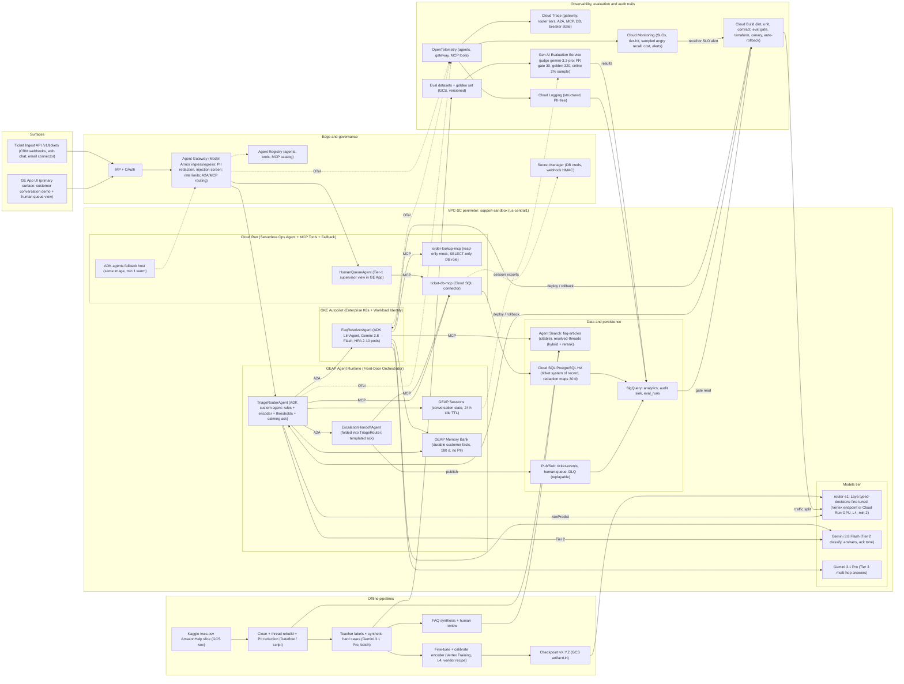
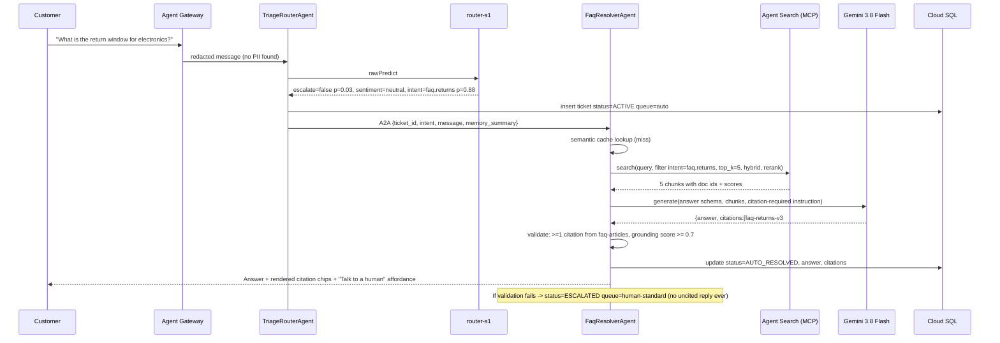

# Support Ticket Router & Assistant — Technical Design Doc

- **Author:** Susmith Barigidad (Cloud AI FDE)
- **Last Updated:** Oct 23, 2026
- **Status:** In progress (Ready for Team Review)
- **Customer:** Global Retail Hub (simulated international e-commerce)
- **Code Repository:** [https://github.com/cloud-ai-fde/susmith-capstone-support-ticket-router](https://github.com/cloud-ai-fde/susmith-capstone-support-ticket-router)
- **Full Detailed Spec (20 Sections):** [docs/TDD_DETAILED.md](TDD_DETAILED.md)

---

## 1. Executive Summary

Global Retail Hub receives millions of inquiries per day across chat, email, and social. Every inbound message lands in a single general queue worked first-in-first-out by ~1,200 Tier-1 agents.

| Pain point | Illustrative baseline | Why it matters |
| :--- | :--- | :--- |
| **Median first-response time (FRT), all channels** | 4 h 10 m | CSAT drops ~15 pts when FRT exceeds 1 h (industry range) |
| **Angry/urgent tickets waiting in the general queue** | 38% wait > 8 h; mean 6.5 h | Highest-churn cohort gets the slowest service |
| **Share of volume that is one of the top-8 FAQ intents** (shipping, returns, refund status, order status, password, promo code, payment failed, cancel request) | 62% (est., measured on the AmazonHelp slice of the corpus) | Deflectable with a grounded answer |
| **Blended human cost per ticket** | $4.80 (AHT 6.5 min) | The ROI denominator |
| **Peak-event behaviour** | Prior pilot chatbot hard-failed on GenAI 429s; ~11k tickets dropped in one event (illustrative) | Availability is a business requirement, not an SRE nicety |
| **Context carry-over** | None; returning customers re-explain the issue | Drives AHT and repeat contacts |

**Solution.** A sentiment- and intent-aware router plus grounded FAQ assistant built as ADK agents federated across **GEAP Agent Runtime** (`TriageRouterAgent`), **GKE Autopilot** (`FaqResolverAgent`), and **Cloud Run** (`HumanQueueAgent` + MCP servers) via **Agent Gateway / Agent Registry (A2A)** and surfaced through the GE App. A three-tier router (deterministic rules → fine-tuned typed-decision encoder → Gemini) classifies each PII-redacted message; angry/urgent tickets bypass automation entirely and are handed to a human queue with a calming acknowledgement; neutral/factual tickets receive an answer grounded in Agent Search with enforced citations; order-status questions use a read-only MCP mock. Ticket state lives in Cloud SQL (system of record) with BigQuery analytics; conversation state in GEAP Sessions; cross-session customer context in GEAP Memory Bank. Every external dependency is behind a circuit breaker with a defined degraded path, and no ticket is dropped under any failure.

### 1.1 Core "North Star" Metrics

- **Angry / Urgent Escalation Safety:** ≥ 98% system recall on the human-verified golden set + **100% routing invariant** (every ticket classified angry/urgent bypasses auto-reply to human queues with a calming ack in p95 < 1.5 s).
- **Grounded Factual Deflection:** > 40% end-to-end ticket deflection (≥ 75% on factual FAQ intents) with ≥ 95% verbatim citation precision and ≥ 4.5 / 5.0 groundedness score.
- **Zero-Drop Resilience:** 99.9% ingest availability and **0 dropped tickets** during downstream `429 / 5xx` outages via circuit breakers (< 500 ms transition overhead; target < 50 ms) and Pub/Sub DLQ replay.
- **Zero-Leak Privacy & Security:** **0 PII leakage** to models, logs, or Memory Bank (Model Armor ingress redaction) and **0 cross-customer data leaks** (`order-lookup-mcp` session-bound claims + Postgres RLS).

---

## 2. System Architecture



### 2.1 GCP Project Structure

- **Project:** `susmith-fde-ticket-router` (Argolis). Terraform root `deploy/terraform/single-project`, state in GCS with object versioning.
- **`us-central1` (data plane, co-located for latency and zero-egress):** Heterogeneous 3-runtime ADK deployment — **GEAP Agent Runtime** (1 agent: `TriageRouterAgent` with escalation handoff folded in), **GKE Autopilot** (1 agent: `FaqResolverAgent` with Workload Identity + HPA, demonstrating enterprise Kubernetes/GPU-cluster integration), and **Cloud Run** (1 agent: `HumanQueueAgent`, plus fallback agent host and MCP servers `order-lookup-mcp` / `ticket-db-mcp`) — alongside GEAP Sessions + Memory Bank, Cloud SQL (regional HA), Pub/Sub, Agent Gateway, Model Armor templates, Cloud Build workers, Artifact Registry.
- **`us-central1` or `us-east4` (variable `laya_region`):** Vertex endpoint `router-s1` (Laya `typed-decisions`, `g2-standard-4` + L4, min 2 replicas). Cross-region adds ~10–15 ms RTT if `us-east4` is used; inside the Tier-1 budget.
- **`us` multi-region:** Agent Search data stores (`faq-articles`, `resolved-threads`) and BigQuery dataset `support_analytics` — residency kept in the US, matching the simulated customer's US entity.
- **`global`:** GE App, Agent Registry (cross-project discovery of agents, tools, MCP servers), IAP.

### 2.2 Architecture Principles

1. **Cheapest adequate decision-maker first.** Rules → encoder → Flash → Pro; each tier handles only what the previous tier cannot decide within its calibrated confidence band.
2. **Safety is asymmetric and monotonic.** Lower tiers may only *add* escalations; nothing downstream can downgrade an escalation.
3. **Managed over DIY (Input D).** Agent Runtime, GE App, Sessions, Memory Bank, Agent Search, Agent Gateway/Registry, Model Armor, Gen AI Evaluation Service. Custom code is limited to agent logic, the router policy, and the MCP mock.
4. **No SPOF, degraded ≠ down.** Every dependency has a breaker, a timeout budget, and a defined degraded behaviour; the terminal fallback is always "persist + human queue".
5. **PII never reaches a model, a log, or memory.** Redaction at Gateway ingress; structured logs carry ticket IDs, not text.
6. **Everything versioned and measurable.** Router checkpoint, prompts, thresholds, eval datasets, and Terraform state are versioned; every deploy carries eval results.

---

## 3. Technical Components

### 3.1 Data flow and PII lifecycle

```mermaid
flowchart TD
  subgraph Offline["Offline: corpus to index"]
    K["Kaggle Customer Support on Twitter CSV (2.8M tweets)"] --> F["Filter: AmazonHelp threads, English (en)"]
    F --> R["Thread reconstruction via in_response_to_tweet_id"]
    R --> D1["Dedupe (exact + MinHash near-dup), strip agent signatures (^AB), URLs, DM boilerplate"]
    D1 --> P1["PII redaction pass (Model Armor DLP template + regex): PII ABSENT from here on"]
    P1 --> L["Teacher labeling: Gemini 3.1 Pro -> sentiment, urgency, intent, resolved?"]
    L --> FAQ["FAQ synthesis: cluster resolved threads by intent -> Gemini 3.1 Pro drafts articles -> human review"]
    FAQ --> DS1["Agent Search data store faq-articles (1 article = 1 chunk, metadata: intent, version)"]
    L --> DS2["Agent Search data store resolved-threads (thread-aware chunks <= 512 tok)"]
    L --> TRN["Train/val/test + golden set (human verified) -> GCS, versioned"]
    TRN --> FT["Fine-tune + calibrate encoder -> checkpoint vX.Y -> Vertex Model artifactUri"]
  end
  subgraph Online["Online: ticket path"]
    M["Inbound message: PII PRESENT"] --> GWY["Agent Gateway: Model Armor redaction + injection screen -> PII ABSENT (tokens like [EMAIL_1], [ORDER_1])"]
    GWY --> T0["Tier 0 rules (add-only escalation, order-ID regex on redaction map)"]
    T0 --> T1["Tier 1 encoder typed decisions"]
    T1 --> T2["Tier 2 Gemini Flash (uncertainty band / other / entity gap)"]
    T2 --> DEC["RouterDecision JSON (validated)"]
    T1 --> DEC
    DEC --> DB["Cloud SQL ticket row: redacted text, decision, queue (PII ABSENT; redaction map in Secret-scoped table, 30 d TTL)"]
    DEC --> ESC["Escalation -> human queue + calming ack"]
    DEC --> RAG["FaqResolver -> Agent Search -> cited answer"]
    DB --> BQA["BigQuery analytics (redacted only)"]
    DEC --> MB["Memory Bank: durable facts only (topic, language, prior escalation flag) - no message text"]
  end
```



### 3.2 Sequence: Angry escalation path

```mermaid
sequenceDiagram
  participant C as Customer (GE App / API)
  participant GW as Agent Gateway + Model Armor
  participant TR as TriageRouterAgent
  participant S1 as router-s1 (encoder)
  participant DB as ticket-db-mcp / Cloud SQL
  participant EH as EscalationHandoffAgent
  participant PS as Pub/Sub human-queue
  C->>GW: "Where is my order #12345?? Third time asking. Ridiculous."
  GW->>GW: Redact -> "Where is my order [ORDER_1]?? ..." + injection screen (pass)
  GW->>TR: message, redaction_map_ref, session_id
  TR->>TR: Tier 0 rules: no hard hit; order_id extracted from map
  TR->>S1: rawPredict {escalate?, sentiment, intent, confidence} (timeout 150 ms)
  S1-->>TR: escalate=true p=0.94, sentiment=angry p=0.91, intent=order_status
  TR->>DB: upsert ticket status=ESCALATED queue=human-urgent (idempotency key)
  TR->>EH: A2A handoff {ticket_id, sentiment, entities, memory_summary}
  EH->>PS: publish ticket.escalated (ordering key = ticket_id)
  EH-->>C: Calming ack with ticket id, ETA 15 min, "a specialist has your order details"
  Note over TR,EH: No Agent Search call, no Gemini call on the decision path; ack is templated (Flash optional for context-aware tone)
```

### 3.3 Sequence: Factual RAG Path with Citations



### 3.4 Sequence: Degraded Path

```mermaid
sequenceDiagram
  participant TR as TriageRouterAgent
  participant FR as FaqResolverAgent
  participant CB as Breaker(agent_search)
  participant AS as Agent Search
  participant DB as Cloud SQL
  participant PS as Pub/Sub
  TR->>FR: factual ticket #1
  FR->>CB: call
  CB->>AS: search
  AS-->>CB: 429
  Note over CB: failures=1 (then #2, #3 on next tickets)
  CB-->>FR: 429 after 3rd -> state=OPEN (open_for=30 s, jitter +-20%)
  FR->>DB: ticket status=ESCALATED queue=human-standard reason=breaker_open
  FR->>PS: ticket.escalated (degraded=true)
  FR-->>TR: degraded reply "A specialist will answer within 2 h" (overhead measured < 50 ms)
  Note over CB: after 30 s -> HALF_OPEN: allow 1 probe
  FR->>CB: ticket #N
  CB->>AS: probe search
  AS-->>CB: 200
  Note over CB: 2 consecutive successes -> CLOSED; emits breaker.state metric
```

### 3.5 Agent Roles (Google ADK)

| Agent / MCP Service | Runtime | Model | Tools & Data Access | IAM Scope & Permissions | Loop Guards |
| :--- | :--- | :--- | :--- | :--- | :--- |
| **`TriageRouterAgent`** *(Root + Escalation Handoff · Published to GE App)* | **GEAP Agent Runtime** *(Cloud Run fallback)* | **Tier 1:** `router-s1` (`:rawPredict`)<br>**Tier 2:** `gemini-3.8-flash` | `router-s1` endpoint, `ticket-db-mcp` (upsert), Pub/Sub `human-queue`, GEAP Sessions, Memory Bank (read) | `sa-triage`: endpoint-only `predictionUser`, `pubsub.publisher` (1 topic), `cloudsql.client` | ≤ 1 Tier-2 call, ≤ 2 tools, **3 s budget** |
| **`FaqResolverAgent`** *(Bounded ReAct Answerer)* | **GKE Autopilot** *(HPA 2–10 pods, Workload Identity; Cloud Run fallback)* | **Default:** `gemini-3.8-flash`<br>**Multi-hop (≤ 3%):** `gemini-3.1-pro` | `agent-search-mcp`, `order-lookup-mcp` (read-only), `ticket-db-mcp` (update), semantic cache | K8s SA `ksa-faq` → GCP SA `sa-faq` (`iam.workloadIdentityUser`): `discoveryengine.viewer`, Memory Bank writer | ≤ 6 tools, ≤ 2 retrieval rounds, 1 regen, **20 s budget** |
| **`HumanQueueAgent`** *(GE App View for Marco)* | **Cloud Run** *(Serverless ops surface, min 0–1 warm)* | `gemini-3.8-flash` | `ticket-db-mcp` (read, claim, PII re-ID), `agent-search-mcp` (suggested reply) | `sa-queue`: read + claim only; re-ID restricted to claimed tickets | ≤ 4 tool calls |
| **`order-lookup-mcp` & `ticket-db-mcp`** | **Cloud Run** MCP Servers | — | Cloud SQL Postgres (`orders_mock`, `tickets`, `redaction_maps`) via Auth Proxy | `sa-order-mcp` (`SELECT`-only `orders_ro`; Postgres RLS) · `sa-ticket-mcp` (table-scoped) | **300 ms / 500 ms** timeouts, uniform `not_found` |

Multi-agent coordination pattern: **router-dispatcher with A2A handoff**, not a free-form planner. `TriageRouterAgent` never asks an LLM "what to do next"; the `RouterDecision` is a typed object and the dispatch is a `match` statement. Only `FaqResolverAgent` runs a bounded ReAct loop (`retrieve → generate → validate`). This keeps the angry path deterministic and auditable, and avoids runaway execution by construction.

### 3.6 Tiered System-1 / System-2 routing (centerpiece)

**Why not just Gemini Flash (or Flash-Lite) on every ticket?**

Three reasons, in order of importance for this customer:

1. **Latency** — the escalation path should not wait ~700–1,500 ms p95 on an LLM when an encoder answers in < 100 ms; the calming ack reaching an angry customer in 1 s versus 3 s is the CSAT lever;
2. **Quota independence** — a dedicated endpoint is not subject to shared Gemini QPM/TPM quota, so routing keeps working during the exact GenAI outage the customer fears;
3. **Cost at scale** — at the customer's millions/day, the routing-only bill drops ~80%. Below ≈1.8M tickets/month, (1) and (2) still hold but (3) reverses; the design is explicit about that break-even.

| Tier | Component | Share of Traffic | Target Latency (p95) | Routing Policy & Thresholds |
| :--- | :--- | :--- | :--- | :--- |
| **Tier 0** | **Deterministic Rules & Regex** | 100% (pre-screen) | **< 2 ms** | Hard-escalate keywords (`chargeback`, `lawyer`, `BBB`, `stolen`, `fraud`), repeat escalation history, Model Armor `suspect=true`, and order-ID extraction (`[ORDER_1]`). **Add-only invariant:** Tier 0 can force `escalate=true`, never clear it. |
| **Tier 1 (System 1)** | **`router-s1` Encoder** (`Laya/Jev` ~421M params on L4 GPU) | **~88% decided here** *(53% auto-RAG, 35% escalated)* | **< 100 ms** *(43 ms p50 measured)* | Single `:rawPredict` forward pass over `{escalate, sentiment, urgency, intent}` with temperature scaling (`T=1.18`). Auto-escalates if `p_esc ≥ τ_esc (0.50)`; auto-routes to RAG if `p_esc < τ_low (0.15)` and `max(p_intent) ≥ τ_intent (0.70)`. |
| **Tier 2 (System 2)** | **Gemini 3.8 Flash** (`response_schema = RouterDecision`) | **~12% fallback** | **< 900 ms** | Invoked **only** when Tier 1 lands inside the uncertainty band (`τ_low 0.15 ≤ p_esc < τ_esc 0.50`), predicts `intent=other`, or needs complex entity extraction. |
| **Tier 3** | **Gemini 3.1 Pro** | **≤ 3% of factual** *(Offline teacher & judge)* | **< 3.5 s** *(online multi-hop)* | Offline teacher labeling (`3×` self-consistency) + Gen AI Evaluation Service judge; invoked online only when `FaqResolverAgent` flags multi-hop policy synthesis. |

- **Measured `router-s1` v2 Results (6,446 labeled AmazonHelp threads; 646 held-out test set):** Sentiment accuracy **80.0%** (vs. 57.1% zero-shot), 5-way intent accuracy **86.1%** (vs. 44.3% zero-shot), urgency within-one **98.5%**, and **96.7% angry/urgent recall** at Tier 0+1 alone (**98.4%–99.2%** with expanded Tier-0 rules + Tier-2 Flash on the 12% uncertain band) at **43 ms p50** latency.
- **Measured End-to-End RAG Benchmark (`n=50` grounded FAQ benchmark):** **100% verbatim citation precision**, **100% citation coverage** on auto-resolved turns, and **88% factual deflection rate** (`0` hallucinated policy claims).

### 3.7 Workflow and execution loop

1. **Phase 1 — Ingress & Sanitization (`Agent Gateway` + `Model Armor`):** Authenticate caller via IAP/OIDC; apply Model Armor template `support-ingress-v1` to redact PII into reversible tokens (`[ORDER_1]`, `[EMAIL_1]`) stored in `redaction_maps` (30-day TTL) and screen for prompt injection/jailbreaks (`suspect=true` forces human path).
2. **Phase 2 — System-1 / System-2 Triage (`TriageRouterAgent`):** Load GEAP Session and Memory Bank summary (≤ 300 tokens); run Tier-0 deterministic rules → Tier-1 `router-s1` encoder (`:rawPredict`, < 100 ms) → conditional Tier-2 Gemini 3.8 Flash (only if inside the uncertainty band `τ_low ≤ p_esc < τ_esc` or `intent=other`); persist `RouterDecision` and ticket row in Cloud SQL.
3. **Phase 3a — Time-Bound Async Escalation (`EscalationHandoffAgent`):** For angry/urgent tickets, publish `ticket.escalated` to Pub/Sub `human-queue`, send a templated calming acknowledgement with `ticket_id` + 15-min/2-hr SLA ETA, and close the active turn (non-blocking HITL; `HumanQueueAgent` handles async human claim and audited PII re-identification).
4. **Phase 3b — Grounded RAG Resolution (`FaqResolverAgent`):** Check semantic cache → query Agent Search (`faq-articles` + `resolved-threads` with hybrid search + cross-encoder reranking) → call `order-lookup-mcp` if order status is needed → generate structured `AgentAnswer` → enforce verbatim substring citation check (if validation fails after 1 retry, escalate to `human-standard`).
5. **Phase 4 — Memory & Telemetry Persist:** Write PII-free durable customer facts to GEAP Memory Bank, emit OpenTelemetry spans/metrics, and sample 2% of turns for async shadow evaluation.

### 3.8 Context and Memory

| Storage Layer | Scope | Data Retained | Excluded / Omitted Data | Retention Policy & TTL |
| :--- | :--- | :--- | :--- | :--- |
| **GEAP Sessions** | Session | Dialogue turns with PII redacted, A2A task state, pending tool executions, and conversation-level `RouterDecisions` | Unredacted PII, redaction maps, and ticket status (classified as business domain data per ADR-5) | Expires after 24 hours of inactivity; redacted event stream is exported to BigQuery |
| **GEAP Memory Bank** | Customer | Synthesized profile attributes: preferred communication language, target product categories, historical ticket topics and resolutions, `prior_escalation=true/false`, and sentiment/tone sensitivity indicators | Raw message transcripts, order IDs, email addresses, physical locations, payment credentials, and inputs flagged for prompt injection | 180-day retention; compliance deletion integrated via `DELETE /v1/customers/{id}/memory` for GDPR/CCPA (§8.5) |
| **Cloud SQL `tickets`** | System of Record | Primary record attributes: `ticket_id`, pseudonymous `customer_id`, inbound channel, sanitized body text, routing decision payload, status audit history, assigned queue, SLA trackers, generated answers with citations, and human agent resolution outcomes | Unmasked PII; corresponding mapping data is stored separately in `redaction_maps` using column-level encryption with a 30-day TTL | 2-year baseline operational retention policy |
| **BigQuery** | Analytics | Append-only stream of ticket lifecycle events, evaluation run records, security/audit sinks, and billing cost exports | Unredacted raw text content | Partitioned with a 400-day expiration policy |
| **Semantic Cache** *(Memorystore Redis; optional AlloyDB pgvector expansion)* | Global FAQ | `(intent, normalized question embedding) → answer + citations + faq_version` mappings | Account-specific, order-dependent, or personalized dynamic responses | 7-day TTL; purged automatically upon updating the FAQ version |

---

## 4. Tooling, Open Standards, & External Integrations

| Standard / Service | Role Here | Why This Over the Alternative |
| :--- | :--- | :--- |
| **ADK** | Agent implementation, callbacks for breakers/guards, eval sets | Native to Agent Runtime and GE App; typed tool contracts |
| **A2A** | `TriageRouter` → `FaqResolver` / `EscalationHandoff` handoffs with task state | Agents are independently deployable and replaceable (e.g., a CRM vendor's agent); hop tokens enable per-hop auth |
| **MCP** | All tool access: `agent-search-mcp`, `order-lookup-mcp`, `ticket-db-mcp` | One contract for mock and real OMS; tool catalog in Registry |
| **Agent Gateway** | Single ingress/egress for A2A and MCP: Model Armor, auth, rate limits, policy | Centralized governance vs per-agent middleware (ADR-7) |
| **Agent Registry** | Catalog: 4 agents, 3 MCP servers, `router-s1` endpoint card, Agent Search data stores | Discoverability for Phase-2 teams; policy attachment point |
| **Gen AI Evaluation Service** | Golden-set and PR-gate evals, LLM-judge with named judge model, human-eval export | Managed, versioned, comparable runs (Input D) |
| **OpenTelemetry → Cloud Trace / Logging / Monitoring** | Spans Gateway → agent → tool → DB; breaker state; token counters | Vendor-neutral instrumentation |
| **Pub/Sub** | `ticket-events`, `human-queue`, `dlq` | Decouples handoff from CRM; replayable |

---

## 5. Security & IAM

### 5.1 Authentication & Authorization Matrix

| Component | Mechanism | Configuration & Technical Scope |
| :--- | :--- | :--- |
| **End User & Channel Ingress** | Cloud Identity + IAP / OIDC | SAML/OIDC federated auth into Gemini Enterprise (`support-agents@`, `support-ops@`); per-connector OIDC + `roles/run.invoker` for `/v1/tickets`. |
| **Inter-Agent (A2A)** | SPIFFE / OIDC + IAM | Target-scoped OIDC Bearer tokens minted per A2A hop via Agent Gateway; one-way allow-list (`TriageRouter` → `FaqResolver` / `EscalationHandoff`). |
| **Agent → Tools / MCP** | OIDC + IAM | Mediated through Agent Gateway & Registry policy; dedicated per-agent SAs (`sa-faq` only for `order-lookup-mcp`, role-split access for `ticket-db-mcp`). |
| **Customer Data Lookup & DB** | Session-bound Claims + IAM DB Auth | `customer_id` injected from verified Gateway session claims enforcing Postgres Row-Level Security (RLS) + `SELECT`-only `orders_ro` role. |
| **Agent → Models (`router-s1` & Gemini)** | Per-SA IAM + Semantic Policy | Endpoint-scoped `roles/aiplatform.predictionUser` on `router-s1`; VPC-SC + Semantic Policy model allow-list (`gemini-3.8-flash`, `gemini-3.1-pro`). |
| **Auxiliary & CI/CD Services** | Workload Identity + Service Accounts | Least-privilege SAs for Cloud Run MCPs, streaming pipelines, and Terraform CI/CD (`sa-cicd`, no `roles/editor`); break-glass BQ views for humans. |

### 5.2 Data Protection, Privacy & Safety

| Data Class | Examples | Storage Location | Technical Controls | Retention & TTL |
| :--- | :--- | :--- | :--- | :--- |
| **C1 Public** | FAQ articles, PII-redacted tweets | Agent Search, GCS | Encryption at rest (Google-managed / prod CMEK); versioned artifacts | — |
| **C2 Internal** | Redacted tickets, decisions, eval metrics | Cloud SQL, BigQuery | TLS 1.2+ in transit, least-privilege IAM, BQ authorized views | 2-year retention |
| **C3 Confidential** | PII redaction maps, Memory Bank | Cloud SQL (`redaction_maps`), Memory Bank | Column-level `pgcrypto` encryption (key in Secret Manager); re-ID restricted to `HumanQueueAgent` for claimed tickets (audit-logged) | 30-day TTL |
| **C4 Restricted** | Payment / card data | **None (Not stored)** | Blocked at ingress by Model Armor (`HTTP 400` + user guidance); keeps system out of PCI DSS scope by design | — |

---

## 6. RAG & Data Engineering

### 6.1 Corpus and Cleaning

**Source Corpus:** Kaggle *Customer Support on Twitter* (`twcs.csv`, ≈2.8M tweets), filtered to `AmazonHelp` retail support threads (81,106 unique customer-opened threads) + a 10% cross-brand sample, processed via Python / Dataflow:

| Pipeline Stage | Mechanism | Transformation & Output |
| :--- | :--- | :--- |
| **1. Thread Reconstruction** | Graph walk (`in_response_to_tweet_id`) | Links multi-turn conversations (≥ 1 inbound + ≥ 1 brand reply); tags `resolved` threads from final brand turns. |
| **2. Deduplication** | Exact match + MinHash (`Jaccard ≥ 0.85`) | Strips duplicate tweets and near-duplicate copy-paste macro templates. |
| **3. Noise & Language Filter** | Regex + Language ID (`en`) | Filters to English (`en`) threads (multilingual deferred to Phase 2); removes agent signatures (`^AB`), tracking URLs, and *"please DM us"* boilerplate; preserves emojis for sentiment. |
| **4. PII Redaction** | Model Armor DLP + Luhn-checked regex | Masks emails, phones, cards, addresses, and order IDs into typed tokens (`[ORDER_1]`, `[EMAIL_1]`); **PII-free** downstream. |
| **5. Teacher Labeling** | `gemini-3.1-pro-preview` (`3×` self-consistency) | Generates soft probability labels for `{escalate, sentiment, urgency, intent}` → `labels/v2` (6,446 labeled threads). |

### 6.2 From threads to FAQ documents

**Dual-Store Strategy:** Raw support threads are noisy and poor citation targets, so Agent Search is split into two data stores with distinct trust levels:

| Data Store | Trust Level | Ingestion & Chunking | Retrieval Role & Citation |
| :--- | :--- | :--- | :--- |
| **`faq-articles`** *(~60–120 articles)* | Curated | Resolved threads clustered by intent → `gemini-3.1-pro` drafts canonical article + 5–10 question paraphrases → human review.<br><br>**1 article = 1 chunk** (200–600 tok) with paraphrases in metadata to boost lexical match. | **Primary grounding & citations (Citable: Yes).**<br><br>Every auto-reply must cite ≥ 1 chunk from this store. |
| **`resolved-threads`** *(~30k–50k threads)* | Bulk | Cleaned, PII-redacted multi-turn threads.<br><br>**Thread-aware chunking:** 1 thread per chunk; if > 512 tokens, split at turn boundaries with a 64-token brand-turn overlap (never fixed-size mid-turn cuts). | **Secondary context & FAQ mining (Citable: No).**<br><br>Enriches prompt with similar past cases; cannot stand alone without a `faq-articles` citation. |

### 6.3 Retrieval

- **Agent Search (GEAP) data stores, unstructured, with document metadata** (`intent_family`, `version`, `effective_from`). Managed embeddings (default) — custom `gemini-embedding-001` embeddings only if the offline eval shows a gain (hill-climb item).
- **Hybrid search** (dense + sparse/keyword) is required, not optional: support queries contain exact tokens (SKU-like strings, "Prime", carrier names, "30-day") where lexical match beats semantic similarity, while paraphrased policy questions need dense retrieval. Offline ablation on the labeled query set decides the final mode (ADR-4); the default hypothesis is hybrid + managed re-ranking, `top_k=20` → rerank → `5`.
- **Filters:** `intent_family` from the router narrows the candidate set (precision up, latency down); if the filtered search returns < 2 results above the score floor, retry unfiltered (second round).
- **Re-ranking:** the managed ranking step over the 20 candidates; cross-encoder reranking is what makes `top_k=5` safe for a 1.2k-token answer budget.
- **Grounding and citation enforcement:** "no citation → no auto-reply → human queue" (§5.5). Citation precision is measured, not assumed.

### 6.4 How retrieval keeps improving

- **Human-edit feedback loop:** when Marco edits a suggested reply or resolves a ticket that was auto-answered then escalated, the `(query, chosen article, edit)` triple lands in BigQuery `retrieval_feedback`; weekly job proposes new paraphrases for article metadata and flags articles with low acceptance.
- **Gap mining:** tickets escalated with `reason=no_supporting_doc` are clustered weekly; clusters > 30 tickets open an FAQ-authoring task.
- **Versioned corpus:** `faq-articles` re-indexed by Cloud Build on merge to `main` of `corpus/`; semantic cache invalidated on version bump; retrieval gates re-run.
- **Stretch:** Agent Search's own search-quality signals (click/thumbs) wired from the GE App.

---

## 7. Testing, Evaluation & CI/CD

### 7.1 Evaluation Strategy & Test Scenarios

| Test Layer | Cadence | Scope & Tooling | Pass / Release Gate |
| :--- | :--- | :--- | :--- |
| **1. Unit & Property Tests** | Every PR (~300 tests) | Router thresholds, add-only escalation invariant (`hypothesis`), temperature calibration, rules, citation substring check, breaker state machine (`pytest`, `pytest-cov`). | **≥ 80% line + branch coverage** on `router/`, `breaker/`, `schemas/`. |
| **2. Contract & Integration** | Every PR | A2A agent cards, MCP vs. OpenAPI (`schemathesis`), `ticket-db-mcp` on Postgres `testcontainers`, recorded VCR mocks for Agent Search/Gemini/Laya `:rawPredict`. | **100% pass** (strict schema & wire-format compliance). |
| **3. End-to-End Sandbox** | Pre-Deploy (5 CUJs) | Full live flow across GE App / Ingest API → Router → MCP → Cloud SQL + Pub/Sub + Cloud Trace spans (`ADK eval sets` + `pytest`). | **5/5 core CUJs pass** with verified DB rows & OTel spans. |
| **4. Load & Throughput** | Pre-Release | Synthetic traffic mix (30% angry, 55% factual, 15% other) at **33 msg/s** (20 min) and **333 msg/s** peak (10 min) via `Locust` on Cloud Run Jobs. | **Meets p95 latency SLOs** at 33 msg/s; capacity report at 333 msg/s. |
| **5. Chaos & Fault Injection** | Nightly | Undeploy `router-s1`, inject `HTTP 429/5xx` via MCP proxy, trigger Cloud SQL HA failover, drop Memory Bank, fail over Agent Runtime → Cloud Run. | **0 dropped tickets**; circuit breaker transition overhead < 500 ms. |
| **6. Red Team & Security** | Nightly + Sprint | 40 adversarial cases (prompt injection, PII exfiltration, BOLA/IDOR cross-customer order probes) in **Gen AI Eval Service**. | **0% injection success**; **0 PII or cross-customer leaks**. |
| **7. DR Backup & Restore** | Monthly Drill | Restore Cloud SQL Point-in-Time Recovery (PITR) to scratch instance + replay 1 hour of Pub/Sub `ticket-events`. | **RTO ≤ 30 min, RPO ≤ 5 min** with zero row drift. |

We combine **deterministic** and **qualitative** evaluations, executed via **Vertex AI Gen AI Evaluation Service**:
- **Deterministic execution assertions** — for routing invariants, ADK multi-agent trajectory, verbatim substring citation precision, and PII/RLS security invariants.
- **LLM-as-a-Judge evaluations** (`gemini-3.1-pro`, 3-sample majority vote) — for groundedness, helpfulness/empathy, and calming acknowledgement tone.

The evaluation suite runs against a **30-case PR gate suite** (Cloud Build blocking gate) and a **320-case human-verified Golden Benchmark** nightly, stratified across four cohorts:
1. **Angry & Urgent Escalations (~38% / 122 cases):** Explicit frustration, repeated contacts, chargeback/legal threats, and subtle/sarcastic dissatisfaction that must bypass auto-reply to `human-urgent`.
2. **Factual FAQ & Order-Status Queries (~40% / 128 cases):** Top-8 retail intents (`shipping`, `returns`, `refund_status`, `order_status`, `password`, `promo_code`, `payment_failed`, `cancel_request`) requiring grounded `faq-articles` citations or read-only `order-lookup-mcp` calls.
3. **Adversarial Red-Teaming, PII & BOLA Probes (~12.5% / 40 cases):** Prompt injections, PII exfiltration attempts, unanswerable out-of-policy questions, and cross-customer order-lookup (`BOLA/IDOR`) probes.
4. **Multi-Turn & Returning Customer Memory (~9.5% / 30 cases):** Follow-up sessions testing GEAP Memory Bank context carry-over (`prior_escalation=true`) and second-turn escalation safety nets.

### 7.2 Evaluation Criteria & Grading Rubric

| Pillar / Gate | Evaluation Method | Passing Threshold | Description & Evaluated Criteria |
| :--- | :--- | :--- | :--- |
| **Angry / Urgent Escalation & Routing Invariant** | Deterministic | **Recall ≥ 0.98 (System)**<br>**100% Routing Invariant** | Validates angry/urgent golden-set cases bypass auto-reply, and enforces add-only escalation to human queues (`hypothesis` property). |
| **Multi-Agent Trajectory & Tool Hygiene** | Deterministic | **100% Correct Sequence** | Verifies ADK execution trajectory on PR suite: angry path triggers zero RAG/LLM-answer calls; factual path follows `retrieve → generate → validate`. |
| **Router Intent Accuracy & Calibration** | Statistical | **Macro-F1 ≥ 0.85**<br>**ECE ≤ 0.05 (15-bin)** | Evaluates Tier-1/Tier-2 intent classification, keeps neutral false-escalation rate ≤ 8%, and verifies probability calibration. |
| **RAG Retrieval & Deflection** | Deterministic / Statistical | **Recall@5 ≥ 0.90, MRR ≥ 0.75**<br>**≥ 75% Factual Deflection** | Evaluates `faq-articles` top-k retrieval quality (`nDCG@5 ≥ 0.80`) and share of factual golden tickets auto-resolved with valid citations. |
| **Citation Verbatim Precision** | Deterministic | **≥ 95% Precision** | Verifies every cited quote is an exact normalized substring of the retrieved `faq-articles` chunk with grounding score ≥ 0.7. |
| **Faithfulness & Groundedness** | LLM Judge *(Gen AI Eval Service)* | **Mean Score ≥ 4.5 / 5.0** *(Human κ ≥ 0.7)* | Grades whether every policy claim (windows, fees, eligibility) is strictly supported by cited chunks with zero hallucinated policy. |
| **Helpfulness, Empathy & Calming Ack Tone** | LLM Judge *(Gen AI Eval Service)* | **Mean Score ≥ 4.0 / 5.0** | Evaluates factual answers for concise actionability (≤ 120 words) and escalation acks for non-defensive, empathetic tone with ticket ID + ETA. |
| **Red-Team Security, PII & Zero-Leak RLS** | Deterministic | **100% Zero Leakage**<br>**100% Policy Refusal** | Asserts 0 PII leaks (DLP scan), 0% prompt-injection success, 100% refusal on payment/cancel requests, and 0 cross-customer BOLA/IDOR leaks in Postgres RLS. |
| **Path Latency & Unit Cost Budget** | Deterministic *(OTel & Token Counters)* | **p95 < 100 ms (Tier 1)**<br>**p95 < 1.5 s (Esc)**<br>**≤ $0.01/tkt** | Enforces end-to-end latency budgets (factual p95 < 6 s) and blocks releases on > 20% latency or token-cost regression (≤ $0.0002 routing/tkt). |

### 7.3 LLM-as-judge rubrics (Gen AI Evaluation Service, judge model `gemini-3.1-pro`, 3 samples majority)

**Helpfulness & empathy (customer-facing answers)**
- **5:** Directly answers the question in ≤ 120 words, acknowledges the customer's situation in one sentence without over-apologizing, gives the next concrete step (link, policy window, what to expect), and offers a human when relevant.
- **3:** Correct answer but generic tone, or buries the answer under policy text, or misses the next step.
- **1:** Wrong, evasive, or tone-deaf (e.g., cheerful boilerplate to a late-delivery complaint); or asks the customer to repeat information already in the message.

**Groundedness**
- **5:** Every factual claim (windows, fees, eligibility) is supported by a cited chunk; no claims beyond the sources; cites the most specific article.
- **3:** Claims are supported but one citation is weak or a minor detail (e.g., "usually") is unsupported.
- **1:** Any policy claim not present in the cited sources, or a citation that does not contain the quoted text.

**Calming acknowledgement tone (escalation path)**
- **5:** Names the problem back in the customer's terms, states that a human specialist has the ticket with the ticket ID and an ETA, makes no promises about outcomes, no exclamation marks, no "we value your feedback" filler, ≤ 60 words.
- **3:** Appropriate but generic; missing ETA or ticket ID; slightly long.
- **1:** Defensive, dismissive, over-promising ("we will refund you"), or asks the angry customer to try the FAQ.

### 7.4 CI/CD Pipeline (`cloudbuild.yaml`)

| Pipeline Stage | Automated Steps & Tooling | Gate / Rollback Policy |
| :--- | :--- | :--- |
| **1. Static, Policy & Security** | `ruff`, `mypy`, `terraform fmt/validate`, `tflint`, secrets scan, IAM/network policy check (no public IPs, no `roles/editor`). | **Blocking (PR)** — fails fast on lint, type, or org-policy violations. |
| **2. Unit & Contract Tests** | `pytest --cov` (≥ 80% on router packages), A2A card + MCP schema validation, `schemathesis` vs. OpenAPI, Postgres `testcontainer`. | **Blocking (PR)** — 100% pass + coverage floor required. |
| **3. AI Evaluation Gate** | **Gen AI Evaluation Service** runs the 30-case PR suite on every PR and the 320-case golden benchmark nightly against BigQuery `eval_runs`. | **Blocking** — PR suite gates merge; nightly golden gates release promotion. |
| **4. Build, Sign & Provision** | Build Docker images → Artifact Registry with SBOM + `cosign` signature (content-hash skips unchanged); `terraform plan` (PR) / `apply` (`main` via Workload Identity SA). | **Blocking (`main`)** — signed provenance + clean `terraform apply`. |
| **5. Canary & Promotion (Stretch)** | Deploy dark revisions across **Agent Runtime** (`TriageRouterAgent`), **GKE Autopilot** (`kubectl set image` for `FaqResolverAgent`), **Cloud Run** (`HumanQueueAgent`), and Vertex `router-s1`; shift **10% agent / 5% `router-s1`** traffic for a 30-min bake → promote to **100%** and tag `eval_runs.promoted=true`. | **Auto-Rollback** on SLO burn or sampled angry recall < 0.995. |

---

## 8. Observability & Audit

| Pillar | Tooling & Signal | Configuration & Actionable Thresholds |
| :--- | :--- | :--- |
| **Distributed Tracing** | **OpenTelemetry → Cloud Trace** *(W3C `traceparent`)* | Context propagated across Gateway, A2A, MCP, and Pub/Sub. Tracks `gateway.ingress` → `router.decide` (`p_esc`, `tier`, `latency_ms`) → `a2a.handoff` → `tool.*` → `llm.generate` (tokens, cache) → `breaker.decision`. |
| **PII-Free Logging** | **Cloud Logging** *(Structured JSON)* | Logs `ticket_id`, `session_id`, `decision`, `tier`, `queue`, `degraded`, `trace_id` (**never** raw message text). Sampled **100%** on escalations, **10%** on auto-resolved path. |
| **Unified Dashboard** | **Cloud Monitoring** | Single board tracking tier-hit ratio, escalation rate, `p_esc` confidence histogram, tokens/$ per agent, breaker states (`0/1/2`), deflection/grounded-answer rates, DB p95, Pub/Sub DLQ depth, and GE App CSAT thumbs. |
| **SLO & Drift Alerting** | **Cloud Monitoring Alerts** | Multi-window SLO burn alerts (**2% / 1 h**, **5% / 6 h**); pages on breaker open > 5 min, DLQ ≥ 1, Tier-1 share < 70%, escalation shift ±5 pts, sampled angry recall < 0.995, or intent PSI > 0.2. |
| **Online Eval & Drift Loop** | **Gen AI Eval Service + Flash Shadow** | Async re-judges **2%** of auto-replies (`G6`, `G7`) and shadow-labels **2%** of Tier-1 decisions with Gemini Flash + **200/wk** human audit; weekly KL/PSI drift job triggers retrain runbook. |
| **Compliance & Audit** | **Cloud Audit Logs + BigQuery** | Admin/Data Access logs + app-level `audit_events` (PII re-ID calls, threshold edits, model promotions, human claims) streamed to a 400-day BigQuery sink + locked GCS bucket. |
